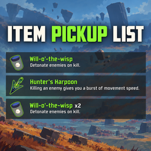

# Item Pickup List

Turns item and equipment pickup notifications into a compact HUD list, positioned on the left by default. Notifications speed up as more entries accumulate, so the list can keep up with rapid pickups.

## Features

- Item and equipment icons, names, pickup descriptions, and item stack counts.
- Nine position presets: top, middle, or bottom, aligned left, center, or right.
- Custom X/Y offsets and UI scale.
- Adjustable duration, queue acceleration, maximum speed, entry interval, and visible entry limit.
- In-game settings through **Risk of Options**, with a matching mod icon.
- A **Reset to defaults** button to restore all original mod settings and save them immediately.
- Configurable test shortcut (**F8** by default) and a **Preview list** button to preview five items without collecting anything.
- Disabling the mod restores normal notification handling for subsequent pickups.

## Build from source

See [BUILDING.md](BUILDING.md) for local setup and build instructions. The project targets `netstandard2.1` and references assemblies from your own Risk of Rain 2 installation and mod profile. Game and dependency DLLs are not included in this repository.

## Installation

### Mod manager

Install with **r2modman** or **Thunderstore Mod Manager**. The dependencies listed in the manifest are installed automatically.

### Manual installation

1. Install **BepInExPack** and **Risk of Options**, including their dependencies.
2. Copy `plugins/ItemPickupList/ItemPickupList.dll` into your game's or mod profile's `BepInEx/plugins/ItemPickupList/` directory.
3. Launch the game.

## Configuration

Open the **Risk of Options** mod settings and select **ItemPickupList**. Settings apply while the game is running. All mod settings, descriptions, buttons, and log messages are in English:

| Section | Setting | Purpose |
| --- | --- | --- |
| General | Enabled | Enable or disable the replacement list |
| General | Reset to defaults | Restore every mod setting to its original default |
| Position | Preset | Choose an anchor on the screen |
| Position | X / Y | Horizontal / vertical offset; positive means right / up |
| Position | Scale | Scale the HUD list |
| Position | Preview list | Preview five example items |
| List | Base duration | Display duration without queue acceleration |
| List | Acceleration per item | Speed increase for each additional entry |
| List | Maximum speed | Maximum speed multiplier |
| List | Entry interval | Delay between entries |
| List | Maximum visible | Maximum simultaneous visible entries |
| Preview | Preview shortcut | Bind the preview shortcut; default: F8 |

The generated configuration file is `BepInEx/config/rfaael.ItemPickupList.cfg`.

For a combination such as Ctrl+F8, hold the configured modifier before pressing the main key. Other held keys do not block the shortcut. Each press triggers one preview batch.

## Restore default settings

Under **General**, click **Reset to defaults** and then **Reset all**. This restores all settings, including the enabled toggle and preview shortcut, and saves them to the configuration file. No game restart is required. If a control still displays a previous value, reopen the mod settings page.

| Setting | Default |
| --- | --- |
| Enabled | On |
| Preset | MiddleLeft |
| X / Y | 0 / 0 |
| Scale | 1.0x |
| Base duration | 4 seconds |
| Acceleration per item | 0.35 |
| Maximum speed | 6.0x |
| Entry interval | 0.35 seconds |
| Maximum visible | 6 |
| Preview shortcut | F8 |

## Scope and compatibility

- This mod changes pickup notifications for the local player; it does not grant items or change item effects.
- Transformations and notification types the mod does not handle keep their original presentation.
- Local split-screen users share one overlay; separate lists for each viewport are not implemented.
- Other mods that suppress or replace the same notifications may affect compatibility.
- Development and collection testing were performed by the author on Risk of Rain 2 **1.5.0**. Test the packaged DLL, icons, and shortcut before publishing an update.

## Troubleshooting

If the list does not appear, check that **Enabled** is enabled and the configured position is on-screen. Press the test shortcut or use the preview button.

When reporting an issue, include the game version, mod version, mod list, and `BepInEx/LogOutput.log`. Useful log entries include `Hooked local notification queue`, `Pickup`, and `Preview`.

## Credits and license

Created by rfaael, with AI assistance during development and cover creation.

Mod source code is available under the **MIT License**; see `LICENSE`. Risk of Rain 2 artwork, item icons, and other game assets belong to their respective rights holders and are not relicensed by this package.
